# Упрощённая система учёта конструкторского состава изделия
Упрощённая система учёта конструкторского состава изделия: импорт из «CAD- файлов», хранение в реляционной базе данных, расчёты по дереву состава и desktop-интерфейс. импорт документовиз CAD-выгрузки (JSON-эмуляция, готовая к замене на API КОМПАС-3D), хранениев PostgreSQL, расчёты по дереву состава, десктопный интерфейс (Avalonia).

## Общий вид + сводка импорта


## Схема работы системы

```mermaid
flowchart TD

subgraph group_desktop["Desktop interface"]
  node_app["App composition<br/>[AppServices.cs]"]
  node_mainvm["Main window VM"]
  node_mainview["Main window"]
  node_importreport["Import report"]
  node_summary["Summary view"]
end

subgraph group_import["CAD import"]
  node_cadfiles["CAD export files"]
  node_reader["JSON CAD reader"]
  node_cadmodel["CAD document model<br/>[CadDocument.cs]"]
end

subgraph group_domain["Domain logic"]
  node_analyzer["Import analyzer<br/>[ImportAnalyzer.cs]"]
  node_reimport["Re-import rules<br/>[ReImportRules.cs]"]
  node_bomcalc["BOM calculations<br/>[BomCalculator.cs]"]
end

subgraph group_data["Data services"]
  node_importservice["Import orchestration<br/>[ImportService.cs]"]
  node_objects["Object repository"]
  node_snapshots["Import snapshots"]
  node_bomlinks["BOM links"]
  node_versions["Version service<br/>[VersionService.cs]"]
  node_state["State service<br/>[PdmStateService.cs]"]
  node_uiread["UI read facade<br/>[UiReadService.cs]"]
  node_bomrepo["BOM repository<br/>[BomRepository.cs]"]
end

node_user(("Engineer"))
node_postgres[("PostgreSQL")]

node_user -->|"uses"| node_mainview
node_mainview -->|"presents"| node_mainvm
node_app -->|"registers"| node_reader
node_app -->|"registers"| node_importservice
node_app -->|"registers"| node_uiread
node_app -->|"registers"| node_state
node_mainvm -->|"invokes"| node_importservice
node_mainvm -->|"invokes"| node_uiread
node_mainvm -->|"invokes"| node_state
node_cadfiles -->|"reads"| node_reader
node_importservice -->|"reads documents"| node_reader
node_reader -->|"produces"| node_cadmodel
node_importservice -->|"analyzes"| node_analyzer
node_analyzer -->|"validates"| node_cadmodel
node_importservice -->|"applies rules"| node_reimport
node_importservice -->|"writes objects"| node_objects
node_importservice -->|"writes versions"| node_versions
node_importservice -->|"loads snapshots"| node_snapshots
node_importservice -->|"writes links"| node_bomlinks
node_importservice -->|"commits transaction"| node_postgres
node_objects -->|"queries"| node_postgres
node_versions -->|"updates versions"| node_postgres
node_state -->|"delegates"| node_versions
node_uiread -->|"reads objects"| node_objects
node_uiread -->|"reads BOM"| node_bomrepo
node_bomrepo -->|"loads tree"| node_postgres
node_mainvm -->|"calculates mass"| node_bomcalc
node_bomcalc -.->|"provides summary"| node_summary
node_mainview -->|"shows report"| node_importreport
node_mainview -->|"shows summary"| node_summary

click node_app "https://github.com/deliciousnesquik/mini-pdm-system/blob/main/src/MiniPdm.App/AppServices.cs"
click node_mainvm "https://github.com/deliciousnesquik/mini-pdm-system/blob/main/src/MiniPdm.App/ViewModels/MainWindowViewModel.cs"
click node_mainview "https://github.com/deliciousnesquik/mini-pdm-system/blob/main/src/MiniPdm.App/Views/MainWindow.axaml.cs"
click node_importreport "https://github.com/deliciousnesquik/mini-pdm-system/blob/main/src/MiniPdm.App/ViewModels/ImportReportViewModel.cs"
click node_summary "https://github.com/deliciousnesquik/mini-pdm-system/blob/main/src/MiniPdm.App/ViewModels/SummaryViewModel.cs"
click node_reader "https://github.com/deliciousnesquik/mini-pdm-system/blob/main/src/MiniPdm.Cad.Json/JsonCadDocumentReader.cs"
click node_cadmodel "https://github.com/deliciousnesquik/mini-pdm-system/blob/main/src/MiniPdm.Core/Cad/CadDocument.cs"
click node_analyzer "https://github.com/deliciousnesquik/mini-pdm-system/blob/main/src/MiniPdm.Core/Import/ImportAnalyzer.cs"
click node_reimport "https://github.com/deliciousnesquik/mini-pdm-system/blob/main/src/MiniPdm.Core/Import/ReImportRules.cs"
click node_importservice "https://github.com/deliciousnesquik/mini-pdm-system/blob/main/src/MiniPdm.Data/Services/ImportService.cs"
click node_objects "https://github.com/deliciousnesquik/mini-pdm-system/blob/main/src/MiniPdm.Data/Repositories/PdmObjectRepository.cs"
click node_snapshots "https://github.com/deliciousnesquik/mini-pdm-system/blob/main/src/MiniPdm.Data/Repositories/PdmObjectSnapshotRepository.cs"
click node_bomlinks "https://github.com/deliciousnesquik/mini-pdm-system/blob/main/src/MiniPdm.Data/Repositories/BomLinkRepository.cs"
click node_versions "https://github.com/deliciousnesquik/mini-pdm-system/blob/main/src/MiniPdm.Data/Services/VersionService.cs"
click node_state "https://github.com/deliciousnesquik/mini-pdm-system/blob/main/src/MiniPdm.Data/Services/PdmStateService.cs"
click node_uiread "https://github.com/deliciousnesquik/mini-pdm-system/blob/main/src/MiniPdm.Data/Services/UiReadService.cs"
click node_bomrepo "https://github.com/deliciousnesquik/mini-pdm-system/blob/main/src/MiniPdm.Data/Repositories/BomRepository.cs"
click node_bomcalc "https://github.com/deliciousnesquik/mini-pdm-system/blob/main/src/MiniPdm.Core/Bom/BomCalculator.cs"

classDef toneNeutral fill:#f8fafc,stroke:#334155,stroke-width:1.5px,color:#0f172a
classDef toneBlue fill:#dbeafe,stroke:#2563eb,stroke-width:1.5px,color:#172554
classDef toneAmber fill:#fef3c7,stroke:#d97706,stroke-width:1.5px,color:#78350f
classDef toneMint fill:#dcfce7,stroke:#16a34a,stroke-width:1.5px,color:#14532d
classDef toneRose fill:#ffe4e6,stroke:#e11d48,stroke-width:1.5px,color:#881337
classDef toneIndigo fill:#e0e7ff,stroke:#4f46e5,stroke-width:1.5px,color:#312e81
classDef toneTeal fill:#ccfbf1,stroke:#0f766e,stroke-width:1.5px,color:#134e4a
class node_app,node_mainvm,node_mainview,node_importreport,node_summary toneBlue
class node_cadfiles,node_reader,node_cadmodel,node_postgres toneAmber
class node_analyzer,node_reimport,node_bomcalc toneMint
class node_importservice,node_objects,node_snapshots,node_bomlinks,node_versions,node_state,node_uiread,node_bomrepo toneRose
class node_user toneIndigo
```


## Стек

- `.NET 8`, `C# 12`
- `Avalonia 11.3.0` + `CommunityToolkit.Mvvm`
- `PostgreSQL 16` через docker compose и управление через `Dapper`
- `Jab`, `Serilog` структурированные логи + rolling
- `xUnit`
- `CI` — GitHub Actions проверки: `dotnet build` + `dotnet test` + CodeQL C#

## Тестирование, сборка и запуск

**Требования: `.NET 8 SDK`, `docker` + `docker compose`.**

### Поднимаем PostgreSQL + схема db/init/01_schema.sql применяется автоматически
```bash
docker compose up -d 
```

Проверяем строку подключения клиентского приложения к базе данных
для этого по пути `src/MiniPdm.App/appsettings.json` открываем файл и ищем
строку `ConnectionStrings`, далее если вы используете базу из проекта через 
`docker compose`, тогда нет необходимости менять строку, иначе меняйте на свои данные!

### Тестирование проекта

Обычное тестирование
```bash
dotnet test
```

Тестирование с получением статистики покрытия и прочего
```bash
dotnet test --collect:"XPlat Code Coverage"
```

Сборка всех проектов в решении `mini-pdm-system.sln`
```bash
dotnet build
```

Запуск клиентского приложения
```bash
dotnet run --project src/MiniPdm.App
```

## Структура решения

- `src/MiniPdm.Core`: здесь собрана вся доменная логика — типы, правила состояний, проверка обозначений, разбор импорта, сценарии повторного импорта и расчёт BOM.
- `src/MiniPdm.Cad.Json`: CAD-слой для работы с JSON-файлами и `CadDocument`. Это единственное место, где приводятся к общему виду имена (ADR 0005). В дальнейшем его заменит `API КОМПАС`, при этом будет использоваться та же реализация `ICadDocumentReader`.
- `src/MiniPdm.Data`: работа с `PostgreSQL`. Импорт проходит в рамках одной транзакции, сохраняются версии и ссылка на актуальную версию, для построения дерева применяется рекурсивный CTE, а для интерфейса предусмотрен фасад чтения.
- `src/MiniPdm.App`: пользовательский интерфейс на `Avalonia UI`. Тут есть ленивое дерево, карточка объекта, поиск, импорт с прогрессом и возможностью отмены, отчёты и строка состояния.
- `docs/adr/*`: архитектурные решения (`ADR 0001–0011`) с описанием и обоснованием.

## Данные для проверки

Набор из задания лежит в папке `data/` (cad-export, cad-export-v2). Это нужно, чтобы можно было повторить отчёты ниже. Сначала загружается версия v1, потом объекты подтверждаются через карточку и кнопку "Утвердить", а после этого импортируется v2. В итоге у некоторых деталей меняются данные, на какие именно можно проверить в ручную

## Архитектурные решения

- ADR 0001 — для справочников берём TEXT вместе с CHECK, а не встроенный `ENUM`, чтобы не привязываться к конкретной СУБД и без проблем использовать `Dapper`.  
- ADR 0002 — всю схему поднимаем одним скриптом через docker initdb, без миграций.  
- ADR 0003 — массу храним так: NULL означает «не задана», ноль использовать нельзя. Массу сборки не записываем, а считаем по актуальным версиям дочерних элементов, потому что при хранении она очень быстро устарела бы.  
- ADR 0004 — `current_version_id` обновляет сервис версий, а не триггер. Он же возвращает указатель назад при аннулировании и ставит NULL, если последняя версия тоже аннулирована.  
- ADR 0005 — имена документов приводим к NFC только в одном месте, на уровне адаптера. На диске в macOS/APFS они хранятся в NFD, а в JSON-ссылках — в NFC, и если сравнивать их напрямую, состав развалится.  
- ADR 0006 — в `ICadDocumentReader` добавили метод `ListDocumentsAsync`: обход файлов тоже относится к работе с файловой системой, и выносить его за пределы адаптера не нужно.  
- ADR 0007 — если "ничего не изменилось", сравниваем атрибуты и состав как мультимножество пар: идентификатор потомка плюс количество. Порядок элементов здесь не играет роли.  
- ADR 0008 — циклы запрещены: участники отклоняются, после чего включается каскад, потому что расчёты и CTE не умеют работать с зацикленным графом.  
- ADR 0009 — объект без активной версии всё равно остаётся в дереве через LEFT JOIN и `HasActiveVersion=false`. Расчёт должен показать, кто именно отвечает за неполноту, а не просто промолчать.  
- ADR 0010 — ошибки чтения оформляем через `CadDocumentException`. Туда попадают битый JSON, `formatVersion != 1` и несовпадение `fileName` с диском; бизнес-проверки выполняются только в анализаторе.  
- ADR 0011 — транзакции открывают оркестраторы вроде `ImportService` и `PdmStateService`. Сервисы, которые работают поверх SQL, транзакции не стартуют, а id не выходит за границы Core.

## Что не успел / как бы сделал

- Экспорт сводной спецификации в `CSV` уже почти готов: парсинг и структура `SummaryLine` сделаны, осталось только добавить слой, который будет сохранять файл.
- Вторая СУБД, `MS SQL`, тоже частично подготовлена: SQL уже вынесен в Data, но провайдер для диалекта пока не выделен отдельно. После этого нужно будет сделать интерфейс-провайдер и вынести отдельные куски CTE под каждый диалект.
- Локализация на en технически уже возможна — инфраструктура resx настроена, но сам перевод пока не выполнен.
- Сравнение версий сборки тоже можно сделать без долгой подготовки: все нужные данные уже есть, версии и составы лежат в БД, но сам экран в UI ещё не реализован.
- С UI-тестами пока не всё закрыто: `Avalonia Headless` тесты я ещё не подключал.
